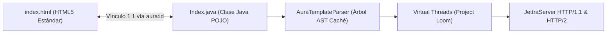
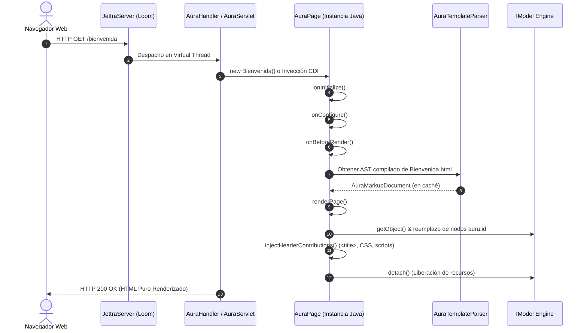
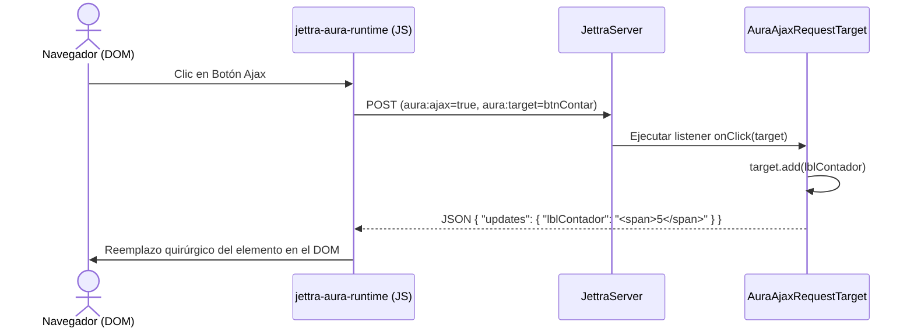

# JettraAura: El Framework Web Orientado a Componentes para Java 25+
**Guía de Referencia y Manual Completo de Arquitectura**
*Autor: Jettra Stack Architecture Team*
*Versión: 1.0.0 (JettraServer Ecosystem)*

---

## Tabla de Contenidos
1. [Introducción y Manifiesto de JettraAura](#capítulo-1-introducción-y-manifiesto-de-jettraaura)
2. [Arquitectura y Separación Estricta 1:1](#capítulo-2-arquitectura-y-separación-estricta-11)
3. [Ciclo de Vida de la Petición y Renderizado](#capítulo-3-ciclo-de-vida-de-la-petición-y-renderizado)
4. [El Sistema de Modelos (IModel)](#capítulo-4-el-sistema-de-modelos-imodel)
5. [Catálogo de Componentes](#capítulo-5-catálogo-de-componentes)
   - [Componentes Base y Contenedores](#51-componentes-base-y-contenedores)
   - [Páginas Web y Metadatos de Cabecera](#52-páginas-web-y-metadatos-de-cabecera)
   - [Componentes de Presentación](#53-componentes-de-presentación)
   - [Formularios y Controles de Entrada](#54-formularios-y-controles-de-entrada)
   - [Repetidores y Listas Dinámicas](#55-repetidores-y-listas-dinámicas)
   - [Paneles Reutilizables y Ventanas Modales](#56-paneles-reutilizables-y-ventanas-modales)
6. [Reactividad y Motor Ajax Parcial](#capítulo-6-reactividad-y-motor-ajax-parcial)
7. [Integración con el Servidor JettraServer](#capítulo-7-integración-con-el-servidor-jettraserver)
8. [Integración con Eclipse MicroProfile y Jakarta EE](#capítulo-8-integración-con-eclipse-microprofile-y-jakarta-ee)
9. [Tutorial Paso a Paso: Aplicación Completa](#capítulo-9-tutorial-paso-a-paso-aplicación-completa)
10. [Buenas Prácticas y Referencia Rápida](#capítulo-10-buenas-prácticas-y-referencia-rápida)

---

## Capítulo 1: Introducción y Manifiesto de JettraAura

### 1.1 ¿Qué es JettraAura?
**JettraAura** es una variante propia, optimizada y simplificada de **JettraFlux** diseñada específicamente para integrar componentes reactivos de Java 25+ directamente en páginas **HTML (`.html`)** y **Jakarta Faces (`.xhtml`)**. Aprovecha los hilos virtuales de **Project Loom**, el motor de almacenamiento desacoplado de **JettraServer** (Memoria Panamá FFM Off-Heap y LSM Disk) y la jerarquía nativa `JettraComponent` / `Widget` de **JettraFlux**, siendo **100% código propio libre de frameworks externos**.

En el panorama actual del desarrollo web, los desarrolladores a menudo se ven obligados a elegir entre dos extremos:
1. Frameworks de servidor basados en lenguajes de plantillas con sintaxis compleja embebida en el HTML (`${...}`, tags JSP/JSF ilegibles, directivas Thymeleaf engorrosas).
2. Arquitecturas SPA (Single Page Applications) monolíticas que trasladan todo el estado al navegador, requiriendo cientos de megabytes de dependencias JavaScript (Node, npm, bundlers complejos) y perdiendo el control de seguridad y consistencia transaccional del backend.

**JettraAura rescata lo mejor de la computación orientada a objetos:**
- El marcado HTML permanece **100% puro y estándar**. Un diseñador puede abrir cualquier plantilla de JettraAura en cualquier navegador o editor visual (VS Code, Figma, Dreamweaver) y visualizar la maqueta sin necesidad de ejecutar un servidor Java.
- Toda la lógica, validación y gestión de estado se escribe en **Java fuertemente tipado**, permitiendo el uso de refactorizaciones automáticas, detección temprana de errores en tiempo de compilación y pruebas unitarias instantáneas con **JettraTest**.



### 1.2 Principios Fundamentales
1. **Separación Absoluta (HTML y XHTML):** Cero código Java ni expresiones complejas dentro de `.html` o `.xhtml`. Los componentes se vinculan mediante los atributos `aura:id` o `flux:id` (o sus alias `j:id`, `data-aura-id`, `data-flux-id`).
2. **Asociación 1:1 y Compatibilidad Jakarta Faces:** Cada plantilla `.html` o `.xhtml` se empareja con una clase Java homónima ubicada en el mismo paquete o ruta de recursos (`ClientePage.html` o `ClientePage.xhtml` $\leftrightarrow$ `ClientePage.java`), soportando además `<aura:extend>`, `<flux:extend>` y `<ui:composition>`.
3. **Interoperabilidad Nativa con JettraFlux:** Todo `AuraComponent` implementa `io.jettra.flux.core.JettraComponent` y ofrece `toFluxWidget()`, mientras que `AuraFluxWidget` permite incrustar cualquier `Widget` o `FluxView` de JettraFlux dentro de una plantilla `.html` o `.xhtml`.
4. **Manejo Transparente de Memoria:** A través de la abstracción `IModel<T>` y `LoadableDetachableModel<T>`, los datos pesados se desacoplan automáticamente al final de cada ciclo de renderizado.
5. **Concurrencia Escala Loom:** JettraAura procesa cada solicitud HTTP y cada evento AJAX dentro de un Virtual Thread de Java 25.

---

## Capítulo 2: Arquitectura y Separación Estricta 1:1

### 2.1 La Convención de Emparejamiento
En JettraAura, una página web está compuesta por dos artefactos inseparables:

1. **La Plantilla de Marcado (`.html`):** Define la estructura visual y diseño. Los elementos interactivos o dinámicos se identifican con `aura:id="nombre"`.
2. **La Clase Controladora (`.java`):** Hereda de `AuraPage` o `AuraWebPage` y añade componentes Java cuyos identificadores coinciden con los del HTML.

#### Ejemplo de Emparejamiento Directo

**Archivo:** `src/main/resources/com/empresa/app/Bienvenida.html`
```html
<!DOCTYPE html>
<html lang="es">
<head>
    <meta charset="UTF-8">
    <title>Título Maqueta</title>
</head>
<body>
    <header>
        <h1 aura:id="tituloPrincipal">Texto de Maqueta Reemplazable</h1>
    </header>
    <main>
        <p aura:id="mensajeUsuario">Mensaje estático para diseño previo</p>
        <a href="#" aura:id="linkPerfil">Ver Mi Perfil</a>
    </main>
</body>
</html>
```

**Archivo:** `src/main/java/com/empresa/app/Bienvenida.java`
```java
package com.empresa.app;

import io.jettra.aura.annotation.AuraPath;
import io.jettra.aura.components.AuraLabel;
import io.jettra.aura.components.AuraLink;
import io.jettra.aura.core.AuraWebPage;

@AuraPath("/bienvenida")
public class Bienvenida extends AuraWebPage {

    public Bienvenida() {
        setPageTitle("Sistema Corporativo - Bienvenida");

        // Enlace 1:1 con h1 aura:id="tituloPrincipal"
        add(new AuraLabel("tituloPrincipal", "¡Bienvenido a la Plataforma Jettra!"));

        // Enlace 1:1 con p aura:id="mensajeUsuario"
        add(new AuraLabel("mensajeUsuario", "Sesión iniciada como Administrador Global."));

        // Enlace 1:1 con a aura:id="linkPerfil"
        add(new AuraLink("linkPerfil", () -> {
            setResponsePage(PerfilUsuario.class);
        }));
    }
}
```

### 2.2 Localizador de Plantillas (`AuraTemplateLocator`)
El componente `AuraTemplateLocator` busca automáticamente la plantilla HTML siguiendo el siguiente orden de resolución:
1. Anotación `@AuraTemplate("ruta/personalizada.html")` sobre la clase Java si existe.
2. Recurso en el classpath con el mismo nombre y paquete que la clase (`io/jettra/aura/MiPagina.html` para `io.jettra.aura.MiPagina`).
3. Recurso en la raíz de templates (`templates/MiPagina.html`).
4. Directorio de recursos web estándar (`web/MiPagina.html`).

---

## Capítulo 3: Ciclo de Vida de la Petición y Renderizado

El procesamiento de una petición en JettraAura pasa por etapas bien definidas y predecibles:



### 3.1 Métodos del Ciclo de Vida en `AuraComponent`
Cualquier componente (o página) puede interceptar y personalizar las siguientes fases del ciclo de vida:

| Método | Momento de Ejecución | Uso Típico |
| :--- | :--- | :--- |
| `onInitialize()` | Una sola vez, al agregarse al contenedor padre (`add`). | Construcción del árbol jerárquico de componentes hijos. |
| `onConfigure()` | Inmediatamente antes de iniciar la renderización. | Modificar visibilidad (`setVisible`), habilitación (`setEnabled`) según roles o estado. |
| `onBeforeRender()` | Justo antes de que el marcado sea transformado. | Cargar datos necesarios para la visualización. |
| `onComponentTag(AuraTag tag)` | Al procesar la etiqueta HTML de apertura. | Modificar atributos HTML (`class`, `style`, `placeholder`, `disabled`). |
| `onComponentTagBody(AuraTag tag, String body, StringBuilder out)` | Al generar el contenido interno de la etiqueta. | Personalizar el texto o formato interno emitido. |
| `detach()` | Al finalizar la solicitud HTTP completa. | Limpiar cachés temporales y liberar referencias pesadas de base de datos. |

---

## Capítulo 4: El Sistema de Modelos (IModel)

El patrón **Model** en JettraAura es la pieza fundamental que desacopla la vista (componentes gráficos) de los datos de negocio. En lugar de que un componente retenga datos estáticos, retiene un `IModel<T>`, garantizando que el valor se consulte en el momento exacto de la renderización.

```
       +---------------------------------------------+
       |               <<interface>>                 |
       |                IModel<T>                    |
       | + getObject(): T                            |
       | + setObject(object: T): void                |
       | + detach(): void                            |
       +---------------------------------------------+
                              ^
        +---------------------+---------------------+
        |                     |                     |
+----------------+   +-------------------+   +---------------------------+
|    Model<T>    |   | PropertyModel<T>  |   | LoadableDetachableModel<T>|
| (Objeto plano) |   | (Reflexivo/POJO)  |   | (Carga Perezosa / DB)     |
+----------------+   +-------------------+   +---------------------------+
        |                     |
+----------------+   +----------------------------+
|  LambdaModel<T>|   | CompoundPropertyModel<T>   |
| (Get/Set Expr) |   | (Auto-binding por aura:id) |
+----------------+   +----------------------------+
```

### 4.1 Tipos de Modelos

#### 1. `Model<T>`
Envoltorio simple para datos en memoria:
```java
IModel<String> nombreModel = Model.of("Juan Pérez");
add(new AuraLabel("nombre", nombreModel));
```

#### 2. `PropertyModel<T>`
Vincula una propiedad específica de un objeto mediante convención JavaBean (getters y setters):
```java
Usuario usuario = new Usuario("Maria", "maria@correo.com");
add(new AuraLabel("nombre", new PropertyModel<>(usuario, "nombre")));
add(new AuraLabel("email", new PropertyModel<>(usuario, "email")));
```

#### 3. `CompoundPropertyModel<T>` (Vinculación Automática)
Asigna el modelo completo al contenedor (por ejemplo, a un formulario o panel). Los componentes hijos sin modelo propio toman automáticamente la propiedad de su objeto cuyo nombre coincide con su `aura:id`:
```java
Usuario usuario = new Usuario("carlos", "admin");
AuraForm<Usuario> form = new AuraForm<>("userForm", CompoundPropertyModel.of(usuario));

// Se vincula automáticamente a usuario.getUsername()
form.add(new AuraTextField<>("username"));

// Se vincula automáticamente a usuario.getPassword()
form.add(new AuraPasswordField("password"));
```

#### 4. `LambdaModel<T>`
Permite vincular métodos Java funcionales directos:
```java
IModel<Integer> saldoModel = LambdaModel.of(
    () -> cuentaService.obtenerSaldo(idCuenta),
    nuevoSaldo -> cuentaService.actualizarSaldo(idCuenta, nuevoSaldo)
);
```

#### 5. `LoadableDetachableModel<T>`
Ideal para consultas a base de datos persistentes o servicios REST. Carga el dato únicamente cuando se invoca `getObject()` y lo descarta al finalizar la solicitud (`detach()`):
```java
IModel<List<Producto>> productosModel = new LoadableDetachableModel<>() {
    @Override
    protected List<Producto> load() {
        return catalogoService.listarProductosActivos();
    }
};
```

---

## Capítulo 5: Catálogo de Componentes

### 5.1 Componentes Base y Contenedores

#### `AuraComponent`
Clase base abstracta de todos los elementos visuales. Provee:
- `getId()`: identificador correspondiente al `aura:id` de la plantilla.
- `setVisible(boolean)`: controla si el componente se emite en el HTML o se omite por completo.
- `setEnabled(boolean)`: añade automáticamente el atributo HTML `disabled="disabled"` si es falso.
- `setOutputMarkupId(boolean)`: genera un `id="aura_comp_X"` único en la etiqueta HTML para permitir manipulaciones DOM y actualizaciones AJAX.
- `addModifier(AuraTagModifier)`: permite agregar clases CSS condicionales o atributos dinámicos.

#### `AuraContainer`
Representa cualquier elemento que puede contener una jerarquía de componentes hijos.
```java
AuraContainer card = new AuraContainer("tarjetaUsuario");
card.add(new AuraLabel("titulo", "Datos de Contacto"));
card.add(new AuraLabel("telefono", "+507 6000-0000"));
add(card);
```

### 5.2 Páginas Web y Metadatos de Cabecera
`AuraWebPage` provee gestión integral de los elementos `<head>`:
```java
public class DetallePage extends AuraWebPage {
    public DetallePage() {
        // Inyecta dinámicamente <title> en el <head>
        setPageTitle("Detalle de Factura #1042");

        // Inyecta estilos CSS y scripts adicionales
        addStylesheet("/css/factura-print.css");
        addScript("/js/impresion.js");

        // Mensajes flash para el usuario
        success("La factura se generó correctamente.");
    }
}
```

### 5.3 Componentes de Presentación

#### `AuraLabel`
Reemplaza el texto interno de cualquier etiqueta HTML (`span`, `div`, `p`, `h1`, `td`, etc.).
```java
// Reemplazo seguro (escapa caracteres HTML automáticamente)
add(new AuraLabel("usuario", "Juan <script>alert(1)</script>")); 

// Reemplazo crudo para fragmentos HTML confiables
add(new AuraLabel("icono", "<strong>Activo</strong>").setEscapeModelStrings(false));
```

#### `AuraBadge`
Emite etiquetas estilizadas con temas de color integrados con JettraFlux:
```java
add(new AuraBadge("estado", "Vigente", AuraBadge.Type.SUCCESS));
```

### 5.4 Formularios y Controles de Entrada

JettraAura maneja formularios tipados con soporte nativo para el protocolo HTTP POST:

```java
AuraForm<Cliente> form = new AuraForm<>("clienteForm", CompoundPropertyModel.of(cliente), () -> {
    // Código ejecutado al enviar el formulario (onSubmit)
    clienteService.guardar(cliente);
    success("Cliente " + cliente.getNombre() + " guardado con éxito.");
});

form.add(new AuraTextField<>("nombre").setRequired(true));
form.add(new AuraTextField<>("identificacion"));
form.add(new AuraCheckBox("activo"));

List<String> ciudades = List.of("Panamá", "David", "Colón", "Santiago");
form.add(new AuraDropDownChoice<>("ciudad", ciudades));

form.add(new AuraButton("btnGuardar"));
add(form);
```

### 5.5 Repetidores y Listas Dinámicas

#### `AuraListView<T>`
Itera colecciones Java clonando el marcado HTML interno para cada fila:

**HTML:**
```html
<table>
    <thead>
        <tr><th>ID</th><th>Nombre</th><th>Precio</th></tr>
    </thead>
    <tbody>
        <tr aura:id="filasProductos">
            <td aura:id="prodId">0</td>
            <td aura:id="prodNombre">Producto</td>
            <td aura:id="prodPrecio">$0.00</td>
        </tr>
    </tbody>
</table>
```

**Java:**
```java
List<Producto> lista = inventarioService.listar();
add(new AuraListView<Producto>("filasProductos", lista, item -> {
    Producto p = item.getModelData();
    item.add(new AuraLabel("prodId", p.getId()));
    item.add(new AuraLabel("prodNombre", p.getNombre()));
    item.add(new AuraLabel("prodPrecio", "$" + p.getPrecio()));
}));
```

### 5.6 Ventanas Modales Interactivas (`AuraModal`) e Interoperabilidad `AuraFluxWidget`

#### `AuraModal` (Diálogos para Registrar, Editar y Confirmar Eliminación)
`AuraModal` es un contenedor reactivo (`AuraContainer`) que permite anidar formularios (`AuraForm`), etiquetas (`AuraLabel`) y botones AJAX (`AuraAjaxButton`) para construir diálogos modales de:
- **Registro de datos** (`registerModal.show(target)`)
- **Edición de registros** (`productModal.show(target)`)
- **Confirmación de eliminación** (`deleteModal.show(target)`)

```java
AuraModal deleteModal = new AuraModal("deleteModal", "🗑️ Confirmar Eliminación");
deleteModal.add(new AuraLabel("deleteConfirmMessage", () -> "¿Eliminar " + seleccionado.getNombre() + "?"));
deleteModal.add(new AuraAjaxButton("btnConfirmDelete", target -> {
    servicio.eliminar(seleccionado.getId());
    deleteModal.hide(target);
    target.add(feedbackPanel, tablaContainer);
}));
add(deleteModal);
```

#### `AuraFluxWidget` y `AuraFacesBridge`
Permiten combinar widgets programáticos de `JettraFlux` con plantillas `.html` y `.xhtml` de Jakarta Faces:
```java
// Incrustar un Widget de JettraFlux en una plantilla .html / .xhtml (<div flux:id="badgeEstado"></div>)
add(new AuraFluxWidget("badgeEstado", Badge.of("Activo en JPA", "success")));

// O renderizar una sección de AuraPage dentro de un Servlet Jakarta Faces (.xhtml)
String sectionHtml = AuraFacesBridge.renderSection(auraCatalogPage);
```

---

## Capítulo 6: Reactividad, Control de Eventos y Motor Ajax Parcial

JettraAura incluye un motor de reactividad parcial en tiempo real. En lugar de recargar la página entera, las acciones Ajax ejecutan métodos Java en el servidor y devuelven una carga JSON quirúrgica con únicamente los nodos HTML que cambiaron.



### 6.1 Ejemplo Práctico de Botón Ajax
```java
int[] contador = new int[]{0};

AuraLabel lblContador = new AuraLabel("contador", LambdaModel.of(() -> contador[0]));
lblContador.setOutputMarkupId(true); // Obligatorio para componentes actualizados vía Ajax
add(lblContador);

add(new AuraAjaxButton("btnIncrementar", target -> {
    contador[0]++;
    target.add(lblContador); // Notifica al cliente que debe refrescar solo este elemento
    target.appendJavaScript("console.log('Contador incrementado a " + contador[0] + "');");
}));
```

---

## Capítulo 7: Integración con el Servidor JettraServer

JettraAura se integra orgánicamente con el servidor de aplicaciones **JettraServer** a través de la clase `AuraModule`.

### 7.1 Configuración y Arranque
```java
package com.empresa;

import io.jettra.aura.server.AuraModule;
import io.jettra.server.core.JettraServer;
import io.jettra.server.core.config.ServerConfig;

public class Main {
    public static void main(String[] args) {
        // Cargar configuración desde microprofile-config.properties o flags
        ServerConfig config = ServerConfig.load().setPort(8080);
        JettraServer server = JettraServer.create(config);

        // Conectar el módulo JettraAura
        AuraModule aura = AuraModule.attach(server);

        // Registrar páginas y definir la página inicial (Home)
        aura.page("/inicio", InicioPage.class);
        aura.page("/catalogo", CatalogoPage.class);
        aura.homePage(InicioPage.class);

        // Iniciar el servidor
        server.start();
    }
}
```

---

## Capítulo 8: Integración con Eclipse MicroProfile y Jakarta EE

### 8.1 Inyección de Dependencias Jakarta CDI (`@Inject`)
JettraAura se conecta con el contenedor `CdiContainer` de `jettra-server-jakarta`. Las páginas instanciadas resuelven automáticamente sus dependencias anotadas con `@Inject`:

```java
@AuraPath("/inventario")
public class InventarioPage extends AuraWebPage {

    @Inject
    private ProductoRepository productoRepo;

    @Inject
    @ConfigProperty(name = "empresa.nombre", defaultValue = "Mi Empresa")
    private String nombreEmpresa;

    public InventarioPage() {
        add(new AuraLabel("empresa", nombreEmpresa));
        add(new AuraListView<>("lista", () -> productoRepo.listarTodos(), item -> {
            item.add(new AuraLabel("nombre", item.getModelData().getNombre()));
        }));
    }
}
```

### 8.2 Arquitectura 100% Zero-XML: Despliegue Programático sin `web.xml`
A diferencia de los frameworks web del pasado, **JettraAura es 100% Zero-XML y no necesita el archivo `web.xml`** para ninguna configuración. La plataforma adopta un enfoque moderno *Code-First* alineado con Java 25 y Jakarta EE 11:

1. **Acople Directo a JettraServer (Loom Virtual Threads):**
   El framework se conecta directamente al router de ultra bajo consumo de memoria de JettraServer sin intermediarios ni descriptores XML:
   ```java
   AuraModule aura = AuraModule.attach(server);
   aura.getApplication().setCdiContainer(jakarta.getCdiContainer());
   aura.page("/inicio", InicioPage.class);
   aura.homePage(InicioPage.class);
   ```

2. **Registro Programático en Contenedores Jakarta EE (Servlet 6.1):**
   Si se requiere convivir con una arquitectura basada en Servlets dentro de JettraServer, el registro se realiza exclusivamente por código Java a través del puente de servlets o `@WebServlet`:
   ```java
   // Registro programático - Cero archivos XML
   jakarta.getServletBridge().registerServlet("/aura/*", new AuraServlet());
   ```

3. **Configuración Declarativa con Eclipse MicroProfile Config:**
   Los parámetros operacionales (puerto, modo de persistencia `storage.mode`, rutas estáticas, timeout de sesiones) se gestionan unificadamente mediante `microprofile-config.properties` o variables de entorno del sistema (`@Inject @ConfigProperty`).

---

### 8.3 Herencia de Plantillas Maestras (`<aura:extend>` y `<aura:child/>`)
JettraAura implementa el patrón de **Herencia Visual de Plantillas**, permitiendo que múltiples páginas compartan una misma maqueta global (Topbar, Menú Lateral Hamburguesa, Cambiador de Tema Claro/Oscuro, Badges de Persistencia y Footer) sin duplicar código HTML:

#### 1. Plantilla Maestra Base (`AuraTemplatePage.html`)
Define la estructura exterior compartida y el marcador `<aura:child/>` donde se incrustará el contenido de las páginas derivadas:
```html
<!DOCTYPE html>
<html lang="es" data-theme="dark">
<head>
    <meta charset="UTF-8">
    <title>JettraAura Enterprise</title>
</head>
<body>
    <header class="layout-top">
        <button type="button" class="hamburger-btn" onclick="toggleSidebar()">☰</button>
        <span>JettraAura Enterprise</span>
        <button type="button" onclick="toggleTheme()">🌙/☀️ Tema</button>
        <span aura:id="topStorageMode" class="badge">JVM_RAM</span>
    </header>

    <div class="layout-wrapper">
        <aside class="layout-left">
            <!-- Menú de navegación global -->
            <a href="/aura/demo">📊 Portal</a>
            <a href="/aura/catalogo">📦 Catálogo</a>
            <a href="/aura/formulario">📝 Formulario</a>
            <a href="/aura/contador">⚡ Contador</a>
        </aside>

        <!-- Punto de inserción de las páginas derivadas -->
        <main class="layout-center">
            <aura:child/>
        </main>
    </div>

    <footer class="layout-footer">
        <span aura:id="footerStorageMode">Modo Persistencia: [JVM_RAM]</span>
    </footer>
</body>
</html>
```

#### 2. Clase Maestra Base (`AuraTemplatePage.java`)
Hereda de `AuraWebPage` e inicializa los componentes compartidos por todas las pantallas:
```java
public abstract class AuraTemplatePage extends AuraWebPage {
    public AuraTemplatePage() {
        add(new AuraLabel("topStorageMode", () -> getEffectiveStorageMode()));
        add(new AuraLabel("footerStorageMode", () -> "Modo Persistencia: [" + getEffectiveStorageMode() + "]"));
    }
}
```

#### 3. Plantilla Derivada con `<aura:extend>` (`MiPagina.html`)
Solo necesita declarar el bloque de contenido específico que reemplazará a `<aura:child/>`:
```html
<aura:extend>
    <div class="ui-card">
        <h2 aura:id="titulo">Contenido Específico de la Pantalla</h2>
        <p aura:id="descripcion">Este fragmento se incrusta en el centro de la plantilla maestra.</p>
    </div>
</aura:extend>
```

#### 4. Clase Derivada (`MiPagina.java`)
```java
@AuraPath("/mi-pagina")
public class MiPagina extends AuraTemplatePage {
    public MiPagina() {
        setPageTitle("Mi Pantalla Específica");
        add(new AuraLabel("titulo", "Gestión de Misión Crítica"));
        add(new AuraLabel("descripcion", "Renderizado con marcado puro e inyección CDI."));
    }
}
```

---

## Capítulo 9: Tutorial Paso a Paso: Aplicación Completa

A continuación desarrollaremos paso a paso un sistema completo de **Gestión de Tareas de Misión Crítica (TaskFlow)** utilizando JettraAura y JettraServer.

### 9.1 Configuración de `pom.xml`
```xml
<dependencies>
    <dependency>
        <groupId>io.jettra</groupId>
        <artifactId>JettraAura</artifactId>
        <version>1.0.0-SNAPSHOT</version>
    </dependency>
    <dependency>
        <groupId>io.jettra</groupId>
        <artifactId>jettra-server-core</artifactId>
        <version>1.0.0-SNAPSHOT</version>
    </dependency>
</dependencies>
```

### 9.2 El Modelo de Datos: `Tarea.java`
```java
package com.empresa.tasks;

import java.io.Serializable;

public class Tarea implements Serializable {
    private String id;
    private String descripcion;
    private String prioridad;
    private boolean completada;

    public Tarea() {}

    public Tarea(String id, String descripcion, String prioridad) {
        this.id = id;
        this.descripcion = descripcion;
        this.prioridad = prioridad;
        this.completada = false;
    }

    // Getters y Setters
    public String getId() { return id; }
    public void setId(String id) { this.id = id; }
    public String getDescripcion() { return descripcion; }
    public void setDescripcion(String descripcion) { this.descripcion = descripcion; }
    public String getPrioridad() { return prioridad; }
    public void setPrioridad(String prioridad) { this.prioridad = prioridad; }
    public boolean isCompletada() { return completada; }
    public void setCompletada(boolean completada) { this.completada = completada; }
}
```

### 9.3 La Plantilla Visual: `TaskPage.html`
```html
<!DOCTYPE html>
<html lang="es">
<head>
    <meta charset="UTF-8">
    <title>Gestión de Tareas</title>
    <style>
        body { font-family: system-ui, sans-serif; background: #0f172a; color: #f8fafc; padding: 2rem; }
        .card { background: #1e293b; border-radius: 8px; padding: 1.5rem; margin-bottom: 2rem; }
        .form-row { display: flex; gap: 1rem; margin-bottom: 1rem; }
        input, select, button { padding: 0.6rem 1rem; border-radius: 4px; border: 1px solid #475569; background: #334155; color: white; }
        button { background: #3b82f6; cursor: pointer; border: none; font-weight: bold; }
        button:hover { background: #2563eb; }
        table { width: 100%; border-collapse: collapse; }
        th, td { text-align: left; padding: 0.75rem; border-bottom: 1px solid #334155; }
        .badge { padding: 0.25rem 0.5rem; border-radius: 4px; font-size: 0.8rem; }
        .ALTA { background: #ef4444; }
        .MEDIA { background: #f59e0b; }
        .BAJA { background: #10b981; }
    </style>
</head>
<body>
    <header>
        <h1 aura:id="appTitle">TaskFlow Pro</h1>
        <div aura:id="alertas"></div>
    </header>

    <main>
        <!-- Formulario de Registro -->
        <div class="card">
            <h3>Registrar Nueva Tarea</h3>
            <form aura:id="taskForm">
                <div class="form-row">
                    <input type="text" aura:id="descripcion" placeholder="Descripción de la tarea..." style="flex: 2;" required />
                    <select aura:id="prioridad" style="flex: 1;"></select>
                    <button type="submit" aura:id="btnAgregar">Agregar Tarea</button>
                </div>
            </form>
        </div>

        <!-- Tabla de Listado -->
        <div class="card">
            <h3>Tareas Registradas</h3>
            <table>
                <thead>
                    <tr>
                        <th>Descripción</th>
                        <th>Prioridad</th>
                        <th>Acciones</th>
                    </tr>
                </thead>
                <tbody>
                    <tr aura:id="taskList">
                        <td aura:id="taskDesc">Descripción ejemplo</td>
                        <td><span aura:id="taskPrioridad" class="badge">ALTA</span></td>
                        <td><a href="#" aura:id="btnEliminar" style="color: #f87171;">Eliminar</a></td>
                    </tr>
                </tbody>
            </table>
        </div>
    </main>
</body>
</html>
```

### 9.4 El Controlador Java: `TaskPage.java`
```java
package com.empresa.tasks;

import io.jettra.aura.annotation.AuraPath;
import io.jettra.aura.components.*;
import io.jettra.aura.core.AuraWebPage;
import io.jettra.aura.model.CompoundPropertyModel;
import java.util.ArrayList;
import java.util.List;
import java.util.UUID;

@AuraPath("/tasks")
public class TaskPage extends AuraWebPage {

    private static final List<Tarea> DB_TAREAS = new ArrayList<>(List.of(
        new Tarea("1", "Configurar nodo de almacenamiento Panamá Off-Heap", "ALTA"),
        new Tarea("2", "Auditar rutas seguras con JWT en JettraSecurityDB", "MEDIA")
    ));

    private final Tarea nuevaTarea = new Tarea();

    public TaskPage() {
        setPageTitle("TaskFlow Pro - Panel Central");

        // 1. Título y Alertas
        add(new AuraLabel("appTitle", "TaskFlow Pro - Gestión Reactiva"));
        add(new AuraFeedbackPanel("alertas"));

        // 2. Formulario con CompoundPropertyModel
        nuevaTarea.setPrioridad("MEDIA");
        AuraForm<Tarea> form = new AuraForm<>("taskForm", CompoundPropertyModel.of(nuevaTarea), () -> {
            if (nuevaTarea.getDescripcion() != null && !nuevaTarea.getDescripcion().isBlank()) {
                nuevaTarea.setId(UUID.randomUUID().toString().substring(0, 8));
                DB_TAREAS.add(new Tarea(nuevaTarea.getId(), nuevaTarea.getDescripcion(), nuevaTarea.getPrioridad()));
                success("Tarea agregada exitosamente.");
                nuevaTarea.setDescripcion("");
            } else {
                error("La descripción no puede estar vacía.");
            }
        });

        form.add(new AuraTextField<>("descripcion"));
        form.add(new AuraDropDownChoice<>("prioridad", List.of("ALTA", "MEDIA", "BAJA")));
        form.add(new AuraButton("btnAgregar"));
        add(form);

        // 3. Tabla Repetidora ListView
        add(new AuraListView<Tarea>("taskList", DB_TAREAS, item -> {
            Tarea t = item.getModelData();
            item.add(new AuraLabel("taskDesc", t.getDescripcion()));
            
            AuraLabel badge = new AuraLabel("taskPrioridad", t.getPrioridad());
            badge.addModifier(tag -> tag.setAttribute("class", "badge " + t.getPrioridad()));
            item.add(badge);

            item.add(new AuraLink("btnEliminar", () -> {
                DB_TAREAS.removeIf(elem -> elem.getId().equals(t.getId()));
                success("Tarea eliminada.");
                setResponsePage(TaskPage.class);
            }));
        }));
    }
}
```

### 9.5 Ejecución en `App.java`
```java
package com.empresa.tasks;

import io.jettra.aura.server.AuraModule;
import io.jettra.server.core.JettraServer;
import io.jettra.server.core.config.ServerConfig;

public class App {
    public static void main(String[] args) {
        ServerConfig config = ServerConfig.load().setPort(8080);
        JettraServer server = JettraServer.create(config);

        AuraModule aura = AuraModule.attach(server);
        aura.page("/tasks", TaskPage.class);
        aura.homePage(TaskPage.class);

        server.start();
        System.out.println("-> TaskFlow ejecutándose en http://localhost:8080/tasks");
    }
}
```

---

## Capítulo 10: Buenas Prácticas y Referencia Rápida

### 10.1 Resumen de Identificadores Soportados
Cualquiera de los siguientes atributos puede utilizarse en el marcado `.html` o `.xhtml` para vincular un componente Java:
- `aura:id="miComponente"` (Predilecto de JettraAura)
- `flux:id="miComponente"` (Sintaxis unificada JettraFlux para plantillas)
- `j:id="miComponente"` (Sintaxis Jettra Frameworks)
- `data-aura-id="miComponente"` / `data-flux-id="miComponente"` (Marcado HTML5 estricto para validadores W3C)

### 10.2 Reglas de Oro de JettraAura
1. **Nunca mantengas entidades Hibernate o conexiones abiertas en el estado del componente:** Utiliza `LoadableDetachableModel` para recargar entidades al renderizar y desacoplarlas al terminar la petición.
2. **Utiliza CompoundPropertyModel para formularios:** Elimina la duplicación de código en formularios vinculando directamente el POJO al formulario padre.
3. **Recuerda setOutputMarkupId(true) para actualizaciones Ajax:** Cualquier componente que deba refrescarse mediante `target.add(comp)` debe tener su atributo HTML `id` habilitado.
4. **Respeta la separación HTML/Java:** Nunca intentes inyectar lógica de negocio mediante concatenación de cadenas dentro de plantillas HTML. Modela el comportamiento en la jerarquía Java de componentes.

