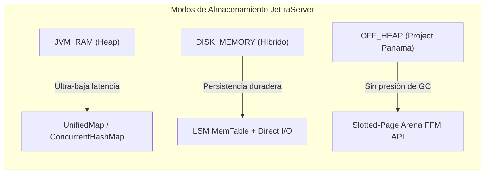

# Manual Maestro de JettraServer 1.0 (The Definitive Guide)

Servidor de aplicaciones modular de ultra-alto rendimiento para **Java 25+**, con soporte integral para **Jakarta EE 11**, **Eclipse MicroProfile**, **Persistencia Tri-Modal**, base de datos embebida **JettraSecurityDB** e interfaces reactivas con **JettraFlux**.

---

## Tabla de Contenidos

1. [Visión General y Filosofía Arquitectónica](#1-visión-general-y-filosofía-arquitectónica)
2. [Arquitectura de Alto Nivel y Módulos](#2-arquitectura-de-alto-nivel-y-módulos)
3. [Motor de Persistencia Tri-Modal (JettraStorageEngine)](#3-motor-de-persistencia-tri-modal-jettrastorageengine)
4. [JettraSecurityDB: Base de Datos Embebida de Seguridad](#4-jettrasecuritydb-base-de-datos-embebida-de-seguridad)
5. [Jakarta EE 11 y Eclipse MicroProfile con CDI Estándar](#5-jakarta-ee-11-y-eclipse-microprofile-con-cdi-estándar)
6. [JettraFlux: Renderizado de Interfaz Reactiva y Swagger-UI](#6-jettraflux-renderizado-de-interfaz-reactiva)
7. [Proyecto de Microservicios: JettraServerBackEndExample](#7-proyecto-de-microservicios-jettraserverbackendexample)
8. [Swagger-UI en JettraServerExample](#8-swagger-ui-en-jettraserverexample)
9. [Framework de Pruebas JettraTest](#9-framework-de-pruebas-jettratest)
10. [Configuración Estándar MicroProfile (`microprofile-config.properties`) y Despliegue](#10-configuración-estándar-microprofile-microprofile-configproperties-y-despliegue)
11. [Contenedorización con Docker y Docker Compose (`bellsoft/liberica-runtime-container:jre-25-stream-musl`)](#11-contenedorización-con-docker-y-docker-compose-bellsoftliberica-runtime-containerjre-25-stream-musl)

---

## 1. Visión General y Filosofía Arquitectónica

**JettraServer** redefine el concepto de servidor empresarial eliminando la sobrecarga, complejidad y lentitud de los contenedores de aplicaciones tradicionales. Desarrollado específicamente para **Java 25+**, explota al máximo las innovaciones del runtime moderno:

- **Virtual Threads (Project Loom):** Manejo masivo de conexiones entrantes sin degradación de rendimiento. Cada socket y cada petición HTTP se procesa en un hilo virtual independiente, eliminando los cuellos de botella de los grupos de hilos del sistema operativo.
- **Generational ZGC (Z Garbage Collector):** Recolección de basura con pausas sub-milisegundo garantizadas y consumo de memoria base inferior a **18 MB**.
- **Arranque en Frío (Cold Start):** Tiempo de inicialización medido entre **0 y 2 milisegundos**, haciéndolo ideal tanto para microservicios de larga duración como para despliegues Serverless o contenedores en la nube.
- **Cero Dependencias de Terceros Pesadas en el Núcleo:** Basado en `java.nio` nativo y abstracciones limpias de alto rendimiento.

```mermaid
flowchart TD
    Client["Cliente HTTP / Navegador / API"] -->|Petición NIO| NioReactor["NioHttpServer (Reactor Loom)"]
    NioReactor --> Router["HttpRouter (Despacho Radix / Hash)"]
    Router --> SecFilter["Filtro de Seguridad / JettraJWT"]
    SecFilter --> SecDB["JettraSecurityDB (Instancia Local)"]
    Router --> AppEndpoints["Endpoints & Recursos REST"]
    Router --> JakartaCont["JakartaContainer (Jakarta EE 11 & MicroProfile)"]
    Router --> FluxEngine["JettraFlux (Render Reactivo UI)"]
    JakartaCont --> CDI["CDI 4.1 (Weld SE Container)"]
    JakartaCont --> JPA["JPA 3.2 & JTA 2.0"]
    AppEndpoints --> Storage["SPI Persistencia Tri-Modal"]
    Storage --> RAM["JVM_RAM"]
    Storage --> DISK["DISK_MEMORY"]
    Storage --> OFFHEAP["OFF_HEAP (Panama FFM)"]
```



---

## 2. Arquitectura de Alto Nivel y Módulos

El proyecto se organiza en una arquitectura multi-módulo consolidada donde **`JettraServer`** actúa como contenedor maestro agregador del ecosistema completo de librerías, motores de persistencia y servidor de aplicaciones:

### 2.1. Núcleo del Servidor y Especificaciones
| Módulo | Ruta | Responsabilidad Principal |
| :--- | :--- | :--- |
| **`jettra-server-core`** | [jettra-server-core](file:///home/avbravo/NetBeansProjects/jettrastack_local/JettraServer/jettra-server-core) | Servidor de red NIO, enrutador HTTP/1.1 con Virtual Threads, persistencia tri-modal, `JettraSecurityDB`, autenticación JWT y métricas. |
| **`jettra-server-jakarta`** | [jettra-server-jakarta](file:///home/avbravo/NetBeansProjects/jettrastack_local/JettraServer/jettra-server-jakarta) | Orquestador Jakarta EE 11 (CDI 4.1 oficial vía Weld SE, Servlet 6.1, Faces 4.1, JAX-RS 4.0, JPA 3.2) y Eclipse MicroProfile 6.1. |
| **`jettra-server-flux`** | [jettra-server-flux](file:///home/avbravo/NetBeansProjects/jettrastack_local/JettraServer/jettra-server-flux) | Motor UI Server-Driven que renderiza componentes interactivos sin concatenación de cadenas mediante árbol de objetos reactivos. Incluye la implementación nativa de **Swagger-UI con Acreditación de Seguridad**. |

### 2.2. Ecosistema de Frameworks Base (Migrados desde `jettraframeworkscontainers`)
| Módulo | Ruta | Funcionalidad |
| :--- | :--- | :--- |
| **`JettraAnnotation`** | [JettraAnnotation](file:///home/avbravo/NetBeansProjects/jettrastack_local/JettraServer/JettraAnnotation) | Anotaciones nucleares y descriptores de configuración para el ecosistema. |
| **`JettraCollections`** | [JettraCollections](file:///home/avbravo/NetBeansProjects/jettrastack_local/JettraServer/JettraCollections) | Colecciones de memoria de ultra-alta velocidad (`UnifiedMap`, mapas compactos y primitivos). |
| **`JettraTest`** | [JettraTest](file:///home/avbravo/NetBeansProjects/jettrastack_local/JettraServer/JettraTest) | Framework moderno de pruebas concurrentes en Java 25 con Virtual Threads (reemplazo sin JUnit). |
| **`JettraJSON`** | [JettraJSON](file:///home/avbravo/NetBeansProjects/jettrastack_local/JettraServer/JettraJSON) | Motor de serialización y deserialización JSON ligero de alto rendimiento. |
| **`JettraRules`** | [JettraRules](file:///home/avbravo/NetBeansProjects/jettrastack_local/JettraServer/JettraRules) | Motor de reglas de negocio declarativo y reactivo. |
| **`JettraJWT`** | [JettraJWT](file:///home/avbravo/NetBeansProjects/jettrastack_local/JettraServer/JettraJWT) | Seguridad criptográfica y tokens web JSON con algoritmos Ed25519 y HMAC. |
| **`JettraCDI`** | [JettraCDI](file:///home/avbravo/NetBeansProjects/jettrastack_local/JettraServer/JettraCDI) | Contenedor de inyección de dependencias y ciclo de vida de componentes. |
| **`JettraGRPC`** | [JettraGRPC](file:///home/avbravo/NetBeansProjects/jettrastack_local/JettraServer/JettraGRPC) | Transporte RPC binario de baja latencia entre servicios distribuidos. |
| **`JettraRest`** | [JettraRest](file:///home/avbravo/NetBeansProjects/jettrastack_local/JettraServer/JettraRest) | Despachador de peticiones REST liviano con mapeo automático de rutas. |
| **`JettraFlux`** | [JettraFlux](file:///home/avbravo/NetBeansProjects/jettrastack_local/JettraServer/JettraFlux) | Librería de widgets UI funcionales e interactivos. |
| **`JettraReport`** | [JettraReport](file:///home/avbravo/NetBeansProjects/jettrastack_local/JettraServer/JettraReport) | Generador de reportes empresariales con scope `provided`. |
| **`JettraStudio`** | [JettraStudio](file:///home/avbravo/NetBeansProjects/jettrastack_local/JettraServer/JettraStudio) | Entorno visual y herramientas de desarrollo para el stack Jettra. |
| **`themes/*`** | [themes](file:///home/avbravo/NetBeansProjects/jettrastack_local/JettraServer/themes) | Temas visuales para aplicaciones web (`Admin`, `AdminLTE`, `Metropolis`, `Tail`, `Traditional`). |

### 2.3. Proyecto Agregador Hermano de Demostración (`JettraServerExamples`)
Ubicado como repositorio y módulo agregador hermano independiente en [`JettraServerExamples`](file:///home/avbravo/NetBeansProjects/jettrastack_local/JettraServerExamples), contiene los proyectos de demostración desacoplados del núcleo del servidor:
| Proyecto | Ruta | Documentación Guía | Descripción |
| :--- | :--- | :--- | :--- |
| **`JettraServerExample`** | [JettraServerExample](file:///home/avbravo/NetBeansProjects/jettrastack_local/JettraServerExamples/JettraServerExample) | [`README.md`](file:///home/avbravo/NetBeansProjects/jettrastack_local/JettraServerExamples/JettraServerExample/README.md) | Aplicación empresarial completa integrando vistas Facelets (`.xhtml`), vistas JettraFlux, beans Jakarta CDI, **Hamburger Menu responsivo**, Swagger-UI y administración de `JettraSecurityDB`. |
| **`JettraServerBackEndExample`** | [JettraServerBackEndExample](file:///home/avbravo/NetBeansProjects/jettrastack_local/JettraServerExamples/JettraServerBackEndExample) | [`README.md`](file:///home/avbravo/NetBeansProjects/jettrastack_local/JettraServerExamples/JettraServerBackEndExample/README.md) | Microservicios REST de backend de alto rendimiento en Java 25+, autenticación estricta JWT Bearer, JettraSecurityDB, Swagger-UI reactivo con gestión de usuarios/roles y ciclo de vida continuo (`await()`). |

---

## 3. Motor de Persistencia Tri-Modal (JettraStorageEngine)

JettraServer integra un subsistema de persistencia de datos mediante el SPI [`JettraStorageEngine<K, V>`](file:///home/avbravo/NetBeansProjects/jettrastack_local/JettraServer/jettra-server-core/src/main/java/io/jettra/server/core/storage/JettraStorageEngine.java). Ofrece tres modos de almacenamiento conmutables en tiempo de ejecución:



### 3.1. `JVM_RAM` (Memoria Heap Estándar)
- **Implementación:** [`JvmRamStorageEngine`](file:///home/avbravo/NetBeansProjects/jettrastack_local/JettraServer/jettra-server-core/src/main/java/io/jettra/server/core/storage/JvmRamStorageEngine.java).
- **Rendimiento:** Latencia sub-microsegundo directa en el Heap de Java aprovechando `UnifiedMap` de `JettraCollections`.
- **Caso de Uso:** Caché en memoria de máxima velocidad y procesamiento efímero.

### 3.2. `DISK_MEMORY` (MemTable LSM con Persistencia en Disco)
- **Implementación:** [`DiskMemoryStorageEngine`](file:///home/avbravo/NetBeansProjects/jettrastack_local/JettraServer/jettra-server-core/src/main/java/io/jettra/server/core/storage/DiskMemoryStorageEngine.java).
- **Rendimiento:** Escrituras atómicas diferidas respaldadas por MemTable de memoria y serialización incremental sobre el sistema de archivos local (`./data/jettra-server/storage`).
- **Caso de Uso:** Aplicaciones que requieren durabilidad entre reinicios con bajo consumo de memoria.

### 3.3. `OFF_HEAP` (Páginas Ranuradas FFM Project Panama)
- **Implementación:** [`OffHeapSlottedPageEngine`](file:///home/avbravo/NetBeansProjects/jettrastack_local/JettraServer/jettra-server-core/src/main/java/io/jettra/server/core/storage/OffHeapSlottedPageEngine.java).
- **Rendimiento:** Utiliza `java.lang.foreign.Arena` y `MemorySegment` de la API de Foreign Function & Memory (FFM) de Java 25. Administra páginas ranuradas de 64 KB fuera del Heap de la JVM, permitiendo almacenar gigabytes de datos sin sobrecargar el Garbage Collector.
- **Caso de Uso:** Sistemas analíticos, microservicios de misión crítica con grandes volúmenes de datos en memoria.

---

## 4. JettraSecurityDB: Base de Datos Embebida de Seguridad

Cada instancia de `JettraServer` está respaldada de forma nativa por su propio motor de base de datos de seguridad embebido: **JettraSecurityDB**.

### 4.1. Arquitectura de Almacenamiento y Concurrencia
- **Estructura en Disco:** Almacenado en `${security.db.path}` (por defecto `./data/jettra-server/securitydb`).
  ```text
  data/jettra-server/securitydb/
  ├── juser/
  │   └── <uuid>.jdb
  ├── jrole/
  │   └── <uuid>.jdb
  ├── jcredential/
  │   └── <uuid>.jdb
  └── jaccreditation/
      └── <uuid>.jdb
  ```
- **Concurrencia Multi-Nivel:**
  1. **Nivel Proceso:** Bloqueo exclusivo a nivel del kernel del SO mediante `java.nio.channels.FileLock`, impidiendo escrituras simultáneas conflictivas entre instancias de la misma máquina.
  2. **Nivel JVM:** Bloqueo justo por colección mediante `ReentrantReadWriteLock(fair = true)`.
- **Cabecera Compacta:** Todo registro se almacena serializado precedido por una cabecera de metadatos de integridad (`CompactHeader`).

### 4.2. Entidades Principales
- [`JUser`](file:///home/avbravo/NetBeansProjects/jettrastack_local/JettraServer/jettra-server-core/src/main/java/io/jettra/server/core/security/entity/JUser.java): Registro inmutable que almacena identificador, `firstName` (nombre de usuario), `email`, teléfono, estado de activación y conjunto ordenado de roles (`Set<JRole>`).
- [`JCredential`](file:///home/avbravo/NetBeansProjects/jettrastack_local/JettraServer/jettra-server-core/src/main/java/io/jettra/server/core/security/entity/JCredential.java): Almacena las credenciales asociadas al usuario con contraseña encriptada mediante algoritmo seguro **SHA-256** y marca de tiempo `lastLogin`.
- [`JRole`](file:///home/avbravo/NetBeansProjects/jettrastack_local/JettraServer/jettra-server-core/src/main/java/io/jettra/server/core/security/entity/JRole.java): Roles del sistema (ej. `ADMIN`, `MANAGER`, `USER`, `DEMO`).
- [`JAccreditation`](file:///home/avbravo/NetBeansProjects/jettrastack_local/JettraServer/jettra-server-core/src/main/java/io/jettra/server/core/security/entity/JAccreditation.java): Privilegios específicos concedidos a roles para acceso a funcionalidades.

### 4.3. Inicialización Automática de Registros Maestros
Al arrancar cualquier instancia de JettraServer, [`JettraSecurityDBInitializer`](file:///home/avbravo/NetBeansProjects/jettrastack_local/JettraServer/jettra-server-core/src/main/java/io/jettra/server/core/security/repository/JettraSecurityDBInitializer.java) valida la existencia de los registros base. Si la base de datos está vacía, aprovisiona de forma automática:
- Roles maestros: `ADMIN`, `MANAGER`, `USER`, `DEMO`.
- Superusuario `admin` con rol `ADMIN` e inmutabilidad garantizada (no puede ser eliminado por la API).
- Credencial para `admin` con contraseña inicial `admin` (hasheada en SHA-256).

### 4.4. Endpoints REST de Seguridad Integrados en JettraServer
El servidor expone automáticamente las siguientes rutas listas para consumir:

| Método | Endpoint | Descripción | Formato Entrada / Salida |
| :--- | :--- | :--- | :--- |
| `POST` | `/api/auth/login` | Inicia sesión y retorna token JWT Bearer. | JSON `{ "username": "admin", "password": "..." }` o Query Params |
| `GET` | `/api/auth/login` | Alternativa de inicio de sesión vía Query Params. | `?username=admin&password=...` |
| `GET` | `/api/auth/me` | Retorna los detalles del usuario autenticado. | Header `Authorization: Bearer <token>` |
| `GET` | `/api/security/users` | Lista de todos los usuarios registrados en JettraSecurityDB. | JSON Array con usuarios y sus roles asignados |
| `GET` | `/api/security/roles` | Lista de todos los roles disponibles en el sistema. | JSON Array con roles |

---

## 5. Jakarta EE 11 y Eclipse MicroProfile con CDI Estándar

El módulo [`jettra-server-jakarta`](file:///home/avbravo/NetBeansProjects/jettrastack_local/JettraServer/jettra-server-jakarta) implementa las versiones más recientes de **Jakarta EE 11** y **Eclipse MicroProfile**, completamente compatible con **Java 25**.

### 5.1. Migración a Jakarta CDI Oficial (Weld SE)
Se ha erradicado por completo el uso de componentes CDI propietarios. JettraServer ahora utiliza directamente el contenedor oficial:
- **Contenedor Oficial:** `org.jboss.weld.se:weld-se-core:6.0.0.Beta4` (Jakarta CDI 4.1).
- **Anotaciones Oficiales Soportadas:**
  - `@Inject`: `jakarta.inject.Inject`
  - `@Named`: `jakarta.inject.Named`
  - `@ApplicationScoped`: `jakarta.enterprise.context.ApplicationScoped`
  - `@RequestScoped`: `jakarta.enterprise.context.RequestScoped`
  - `@SessionScoped`: `jakarta.enterprise.context.SessionScoped`
  - `@PostConstruct` / `@PreDestroy`: `jakarta.annotation.*`
- **Ciclo de Vida Programático:** Administrado mediante [`CdiContainer`](file:///home/avbravo/NetBeansProjects/jettrastack_local/JettraServer/jettra-server-jakarta/src/main/java/io/jettra/server/jakarta/cdi/CdiContainer.java), capaz de arrancar `SeContainerInitializer` de forma limpia o brindar resolución ágil de beans singleton e inyecciones de campos.

### 5.2. Especificaciones Jakarta EE Soportadas
- **Jakarta REST (JAX-RS 4.0):** Despachador nativo con soporte de rutas dinámicas `@Path("/{id}")`, inyección de parámetros `@PathParam`, `@QueryParam` y serialización automática a JSON.
- **Jakarta Servlet 6.1:** Soporte de ciclo de vida HTTP y sesiones concurrentes en memoria.
- **Jakarta Faces 4.1 (JSF & PrimeFaces):** Renderizado de vistas `.xhtml` enlazadas con beans CDI.
- **Jakarta Persistence (JPA 3.2):** `EntityManager` ligero con operaciones `@Entity`, `@Id`, `persist()`, `find()`, `merge()` y `remove()`, mapeado contra el motor de persistencia tri-modal.
- **Jakarta Transactions (JTA 2.0):** Transacciones atómicas de dos fases con `JettraTransactionManager` y soporte de `@Transactional`.
- **Jakarta Concurrency 3.1:** `ManagedExecutorService` respaldado por Virtual Threads de Project Loom.
- **Jakarta Bean Validation 3.1:** Motor de validación declarativa (`@NotNull`, `@Size`, etc.).

### 5.3. Eclipse MicroProfile
Configurado con las especificaciones y APIs ligeras de Eclipse MicroProfile:
- **MicroProfile Config 3.1 (`microprofile-config-api` / SmallRye Config):** Configuración unificada mediante `ConfigProvider.getConfig()`.
- **MicroProfile Health 4.0.1 (`microprofile-health-api`):** Endpoints estándar de liveness y readiness (`/health/live`, `/health/ready`, `/q/health`).
- **MicroProfile Metrics 5.1 (`microprofile-metrics-api`):** Exposición de métricas de rendimiento y de almacenamiento en `/metrics`.
- **MicroProfile Fault Tolerance 4.1 (`microprofile-fault-tolerance-api`):** Tolerancia a fallos, reintentos y disyuntores de circuito (Circuit Breakers).

---

## 6. JettraFlux: Renderizado de Interfaz Reactiva

El módulo [`jettra-server-flux`](file:///home/avbravo/NetBeansProjects/jettrastack_local/JettraServer/jettra-server-flux) provee una alternativa moderna a los motores de plantillas tradicionales basados en concatenación de cadenas (`StringBuilder`):

- **Árbol de Componentes Tipados:** La interfaz se compone instanciando widgets inmutables (`Container`, `Card`, `Badge`, `Grid`, `Table`, `Header`, etc.).
- **Zero Allocations Innecesarias:** El HTML se emite directamente durante el recorrido del árbol, reduciendo drásticamente la presión sobre el recolector de basura.
- **Vistas Reactivas Integradas:**
  - `CatalogoFlux`: Catálogo de productos interactivo con soporte de internacionalización mediante `messages.properties`.
  - `StorageMonitorFluxView`: Dashboard reactivo en tiempo real que visualiza el uso del motor de persistencia tri-modal y métricas de memoria.
  - `TelemetryFluxView`: Métricas de CPU, hilos virtuales de Loom y Garbage Collector.

### 6.1. Swagger-UI con Acreditación de Seguridad y Administración de JettraSecurityDB en JettraFlux
El componente [`SwaggerFluxView`](file:///home/avbravo/NetBeansProjects/jettrastack_local/JettraServer/jettra-server-flux/src/main/java/io/jettra/server/flux/swagger/SwaggerFluxView.java) reemplaza a Swagger-UI JavaScript tradicional por una interfaz moderna, ultra-ligera y reactiva renderizada 100% con widgets de JettraFlux:

- **Diálogos de Mensajes 100% JettraFlux (Cero Popups Nativos JS):**
  - Se eliminaron por completo las llamadas nativas del navegador (`alert()`, `confirm()`, `prompt()`).
  - En su lugar se implementó un **Componente Modal Dialog JettraFlux** nativo (`#jettra-flux-dialog-backdrop`), con backdrop con desenfoque (`backdrop-filter: blur`), cabecera cromática, iconos semánticos, animaciones suaves y soporte para diálogos informativos, de confirmación y formularios interactivos (`prompt`) con navegación accesible por teclado (`Escape` / `Enter`).
- **Flujo de Acreditación en Dos Fases (Login y Aplicación de Token):**
  1. **"🔑 Iniciar Sesión y Acreditarse":**
     - Toma las credenciales (`admin` / `admin`) y las valida contra el endpoint de autenticación `/api/auth/login`.
     - Si la autenticación es exitosa, el servidor emite el JWT Token y la interfaz lo transfiere **de manera automática** al campo de texto de la sección **"Ingresar Token JWT Existente"** (`#jettra-manual-token`), notificando al usuario mediante un diálogo JettraFlux.
  2. **"✓ Aplicar Token":**
     - Al presionar este botón, el cliente verifica criptográficamente la estructura del JWT (3 segmentos Base64), decodifica el payload y valida la vigencia temporal (`exp`).
     - Si el token es válido, se activa la sesión en `localStorage`, se ilumina el indicador de estado en verde (`🔓 Acreditado como: [usuario]`) y se habilitan para prueba interactiva todas las operaciones del catálogo (incluyendo el **Microservicio de Clientes**).
- **Activación Exclusiva de Administración para Usuarios con Rol `ADMIN`:**
  - La sección **"Administración de Usuarios y Roles (JettraSecurityDB)"** permanece **bloqueada por defecto**.
  - **Validación Estricta:** Solo se activa y desbloquea visualmente cuando el usuario aplica un token JWT válido que contenga el rol **`ADMIN`** (o `SECURITY_ADMIN`).
  - Si el usuario no está logeado o se acredita con una cuenta que no es `ADMIN` (ej. solo `USER` o `MANAGER`), la sección de administración permanece oculta y protegida con un mensaje explicativo y badge de acceso denegado.
  - **Seguridad en Backend:** Los endpoints `/api/security/*` implementan inspección criptográfica del encabezado `Authorization: Bearer <token>`, rechazando con `401 Unauthorized` si no hay token o con `403 Forbidden` si el usuario no tiene rol `ADMIN`.
- **Autenticación Obligatoria para Ejecución de Operaciones:**
  - **Todas las operaciones REST de Swagger-UI requieren que el usuario se haya acreditado previamente y posea un JWT Token válido.**
  - Si un usuario no acreditado pulsa "▶ Ejecutar Petición (Execute)" en cualquier microservicio (como *Microservicio de Clientes*), la ejecución se bloquea inmediatamente antes de enviar cualquier solicitud HTTP, desplegando un diálogo JettraFlux que notifica el bloqueo y ofrece un botón directo para desplazarse y enfocar el panel de acreditación.
- **Panel Administrativo Activo (Solo para Administradores):**
  - **Tabla Dinámica en Vivo:** Consulta en tiempo real las colecciones `juser`, `jrole` y `jcredential`, mostrando emails, estado (`● Activo` / `○ Inactivo`), roles concedidos y botón de revocación rápida `×`.
  - **Acciones Directas mediante Diálogos JettraFlux:** Asignación de roles (`➕ Rol`), cambio de contraseñas (`🔑 Clave`), activación/desactivación de cuentas (`⚡`) y eliminación de usuarios (`🗑️`), todas gestionadas con modales JettraFlux.
  - **Formularios de Alta:** Creación de usuarios con credenciales y registro de nuevos roles de sistema.
- **Explorador Interactivo de Endpoints:**
  - Agrupación por tags temáticos y badges cromáticos por verbo HTTP (`GET` en azul, `POST` en verde, `PUT` en ámbar, `DELETE` en rojo).
  - Indicadores de seguridad por endpoint (`🔒 Requiere: [ADMIN]` vs `🌐 Público`).
  - Consola de prueba integrada ("Try it out"): formulario de parámetros de ruta (`PathParam`), consulta (`QueryParam`) y cuerpo JSON editable (`RequestBody`).
  - Inyección automática del encabezado `Authorization: Bearer <token>` en todas las peticiones fetch de prueba.
  - Medición de latencia en milisegundos y visor formateado con resaltado de la respuesta JSON.
- **Habilitación en JettraServer:**
  ```java
  FluxModule.attach(server)
      .swagger("/swagger-ui", "API Microservicios", List.of(CustomerResource.class, OrderResource.class));
  ```

---

## 7. Proyecto de Microservicios: JettraServerBackEndExample

[`JettraServerBackEndExample`](file:///home/avbravo/NetBeansProjects/jettrastack_local/JettraServerExamples/JettraServerBackEndExample) (ubicado dentro de `JettraServerExamples`) es una implementación de referencia orientada exclusivamente a arquitecturas de microservicios backend:

- **Microservicio de Clientes (`CustomerResource`):** Endpoints protegidos para consulta, creación y baja de clientes con validación de roles (`ADMIN`, `MANAGER`, `USER`).
- **Microservicio de Órdenes (`OrderResource`):** Gestión de pedidos, facturación y cancelaciones atómicas.
- **Telemetría y Estado (`SystemInfoResource`):** Ping público para health checks de orquestadores (Kubernetes / Docker) e información del entorno Java 25.
- **Filtro de Seguridad Centralizado:** Valida tokens JWT Bearer contra `JettraSecurityDB` antes de despachar a los microservicios de negocio.
- **Swagger-UI & OpenAPI 3.0.0:** Documentación interactiva en `/swagger-ui` y especificación viva en `/openapi.json`.
- **Modo Demonio y Ejecución Continua (`server.await()`):** `JettraServerBackEndExample` implementa un ciclo de vida persistente en `App.main()`:
  ```java
  public static void main(String[] args) {
      App app = new App();
      app.startApplication(args);

      Runtime.getRuntime().addShutdownHook(new Thread(() -> {
          System.out.println("[App] Solicitud de apagado recibida. Deteniendo JettraServerBackEndExample...");
          app.stop();
      }));

      try {
          System.out.println("[App] Proceso en ejecución continua (escuchando microservicios). Presione Ctrl+C para detener.");
          app.getServer().await();
      } catch (InterruptedException e) {
          Thread.currentThread().interrupt();
          System.out.println("[App] Hilo principal interrumpido. Saliendo...");
      }
  }
  ```
  Esto permite que la aplicación se mantenga corriendo indefinidamente en contenedores Docker, pods de Kubernetes o desde la terminal con `mvn exec:java`, gestionando apagados limpios (*graceful shutdown*) al recibir `SIGINT` o `SIGTERM`.

---

## 8. JettraServerExample: Aplicación Empresarial y Hamburger Menu

El proyecto de demostración web [`JettraServerExample`](file:///home/avbravo/NetBeansProjects/jettrastack_local/JettraServerExamples/JettraServerExample) (ubicado en `JettraServerExamples`) incorpora las tecnologías clave del frontend empresarial moderno:

### 8.1. Hamburger Menu Responsivo y Adaptativo
Para garantizar la mejor experiencia en cualquier resolución de pantalla (móviles, tablets, portátiles y monitores ultra-wide), la plantilla principal [`template.xhtml`](file:///home/avbravo/NetBeansProjects/jettrastack_local/JettraServerExamples/JettraServerExample/src/main/resources/webapp/template.xhtml) implementa un **Hamburger Menu interactivo**:

- **Comportamiento en Escritorio (> 900px):**
  - Al pulsar el botón hamburguesa en la barra superior (`header`), el panel lateral izquierdo (`.layout-left`) se contrae fluidamente con transición cúbica (`margin-left: -260px; opacity: 0;`), expandiendo el área central de trabajo a pantalla completa.
  - El estado preferido se almacena automáticamente en el `localStorage` del navegador (`jettra_sidebar_collapsed`), preservándose entre recargas y navegación de páginas.
- **Comportamiento en Móviles y Tablets (<= 900px):**
  - El menú lateral se oculta por defecto para no obstruir el contenido en pantallas reducidas.
  - Al pulsar el botón hamburguesa, se despliega en modo **Off-Canvas Flotante** (`transform: translateX(0); z-index: 1000; box-shadow: ...`) sobre el contenido.
  - Se activa simultáneamente un fondo oscuro semi-transparente con desenfoque (`.sidebar-backdrop`), permitiendo cerrar el menú tocando en cualquier punto fuera de él.
  - La redimensión de ventana sincroniza automáticamente las clases CSS para evitar estados incoherentes.

### 8.2. Swagger-UI y Especificación OpenAPI
- **Acceso:** Disponible en `http://localhost:8080/swagger-ui` y accesible desde el menú lateral de la interfaz PrimeFaces (`template.xhtml`).
- **Controladores Documentados:** Descubre automáticamente las anotaciones de [`ProductResource`](file:///home/avbravo/NetBeansProjects/jettrastack_local/JettraServerExamples/JettraServerExample/src/main/java/io/jettra/server/example/rest/ProductResource.java) y [`ServerInfoResource`](file:///home/avbravo/NetBeansProjects/jettrastack_local/JettraServerExamples/JettraServerExample/src/main/java/io/jettra/server/example/rest/ServerInfoResource.java).
- **Especificación OpenAPI 3.0.0:** Expuesta en `http://localhost:8080/openapi.json`.

---

## 9. Framework de Pruebas JettraTest

Todo el ecosistema de JettraServer está verificado y garantizado bajo **JettraTest**, un framework de pruebas moderno para Java 25+ sin dependencias de JUnit ni frameworks pesados heredados.

- **Anotaciones:** `@Test`, `@DisplayName`, `@BeforeAll`, `@AfterAll`.
- **Aserciones:** `JettraAssert.assertEquals()`, `JettraAssert.assertTrue()`, `JettraAssert.assertNotNull()`.
- **Ejecución Asíncrona con Virtual Threads:** Las pruebas se ejecutan en paralelo sobre hilos virtuales de Loom, completando suites enteras en menos de 2 segundos.

Para ejecutar toda la suite de pruebas del proyecto:
```bash
mvn clean test
```

---

## 10. Configuración Estándar MicroProfile (`microprofile-config.properties`) y Despliegue

Para alinearse plenamente con **Jakarta EE 11** y **Eclipse MicroProfile 6.1 / MicroProfile Config 3.1**, JettraServer ha sustituido los archivos propietarios por el estándar de la industria `microprofile-config.properties`.

La jerarquía de resolución de configuración estándar es la siguiente:
1. Parámetros explícitos pasados por CLI (`--port`, `--mode`, `--host`)
2. Propiedades de Sistema Java (`-Dprop=val`)
3. Variables de Entorno (`JETTRA_SERVER_*`, `MP_CONFIG_*`, `SERVER_*`)
4. Archivo externo especificado mediante `-Dmicroprofile.config.file=...` o variable de entorno `MP_CONFIG_FILE`
5. Archivo en el directorio de ejecución actual o subdirectorio: `./microprofile-config.properties`, `./META-INF/microprofile-config.properties`, `./config/microprofile-config.properties`
6. Archivo estándar en el classpath: `META-INF/microprofile-config.properties`

### 10.1. Archivo Estándar `META-INF/microprofile-config.properties`
Ubicado en el classpath de todos los módulos (`jettra-server-core`, `jettra-server-jakarta`, `JettraServerExample` y `JettraServerBackEndExample`):
```properties
# ==============================================================================
# ECLIPSE MICROPROFILE CONFIGURATION (MicroProfile Config 3.1)
# JettraServer - Jakarta EE 11 & Eclipse MicroProfile Native Platform
# ==============================================================================

# Perfil activo de configuración MicroProfile
mp.config.profile=production

# Configuración del Servidor y Red
server.host=0.0.0.0
server.port=8080
server.backlog=1024
contextpath=/
server.contextpath=/

# Concurrencia Project Loom (Java 25+ Virtual Threads)
server.virtual-threads=true

# Persistencia Tri-Modal: JVM_RAM, DISK_MEMORY, OFF_HEAP
storage.mode=JVM_RAM
jettra.storage.mode=JVM_RAM
data.dir=./data/jettra-server
storage.offheap.page-size=65536

# JettraSecurityDB (Base de datos embebida de seguridad)
security.db.path=./data/jettra-server/securitydb

# Jakarta Security & JWT Token Authority
server.jwt.secret=jettra_server_super_secure_jwt_key_2026
jwt.secret=jettra_server_super_secure_jwt_key_2026
server.jwt.expiration=86400000
jwt.expiration-millis=86400000

# Políticas de Origen Cruzado (CORS)
cors.enabled=true

# Telemetría y Salud MicroProfile
mp.health.default.readiness.empty.response=UP
mp.metrics.appName=JettraServer
mp.metrics.tags=platform=JettraServer,runtime=Java25,engine=ProjectLoom
mp.fault.tolerance.metrics.enabled=true
```

### 10.2. Variables de Entorno Equivalentes
- `JETTRA_SERVER_PORT` / `SERVER_PORT`: Puerto de escucha del servidor HTTP.
- `JETTRA_SERVER_HOST` / `SERVER_HOST`: Interfaz de red de enlace (ej. `0.0.0.0` o `127.0.0.1`).
- `JETTRA_SERVER_CONTEXT_PATH` / `SERVER_CONTEXTPATH`: Context path base de la aplicación.
- `JETTRA_STORAGE_MODE` / `STORAGE_MODE`: Modo de persistencia (`JVM_RAM`, `DISK_MEMORY`, `OFF_HEAP`).
- `JETTRA_SECURITYDB_PATH` / `SECURITY_DB_PATH`: Ruta base para los archivos de JettraSecurityDB.
- `JETTRA_SERVER_JWT_SECRET` / `SERVER_JWT_SECRET`: Clave secreta para firma y validación de tokens Bearer JWT.

### 10.3. Ejecución desde CLI
```bash
java --enable-preview -jar JettraServerExample-1.0.0-SNAPSHOT-uber.jar --port 8080 --mode JVM_RAM
```
O para el backend de microservicios:
```bash
java --enable-preview -jar JettraServerBackEndExample-1.0.0-SNAPSHOT-uber.jar --port 8083
```
Al arrancar, el servidor imprime su banner informativo indicando los hilos virtuales activos, el modo de persistencia, la ruta de `JettraSecurityDB`, la URL interactiva de Swagger-UI (`/swagger-ui`) y los endpoints REST habilitados.

---

## 11. Contenedorización con Docker y Docker Compose (`bellsoft/liberica-runtime-container:jre-25-stream-musl`)

Tanto [`JettraServerExample`](file:///home/avbravo/NetBeansProjects/jettrastack_local/JettraServerExamples/JettraServerExample) como [`JettraServerBackEndExample`](file:///home/avbravo/NetBeansProjects/jettrastack_local/JettraServerExamples/JettraServerBackEndExample) cuentan con soporte nativo de contenedorización de alto rendimiento basado en **Alpine Linux** con la biblioteca C estándar **musl** y el entorno de ejecución oficial **BellSoft Liberica JRE 25**.

### 11.1. ¿Por qué `bellsoft/liberica-runtime-container:jre-25-stream-musl`?
1. **Ultra-Bajo Consumo (Footprint Mínimo):** La imagen basada en musl reduce el tamaño base a menos de **90 MB**.
2. **Soporte Completo de Java 25:** Integra las últimas características de **Project Loom** (Virtual Threads), **ZGC Generacional** y **JEP 450 (Compact Object Headers)**.
3. **Optimización Cloud-Native:** Reconoce de forma nativa los límites de cgroups en Docker y Kubernetes (`-XX:+UseContainerSupport`).

### 11.2. Empaquetado Autónomo (Fat JAR con `maven-shade-plugin`)
Ambos proyectos configuran `maven-shade-plugin` en su `pom.xml` para generar un **Uber JAR** auto-contenido con todas las dependencias embebidas y un manifiesto ejecutable:
```bash
# Empaquetar artefactos autónomos
mvn clean package -DskipTests
```
Se generan los archivos:
- `target/JettraServerExample-1.0.0-SNAPSHOT-uber.jar` (Aplicación Web Jakarta EE + PrimeFaces + JettraFlux)
- `target/JettraServerBackEndExample-1.0.0-SNAPSHOT-uber.jar` (Microservicios REST + Swagger-UI)

### 11.3. Archivo `Dockerfile` para `JettraServerExample`
Ubicado en [`JettraServerExamples/JettraServerExample/Dockerfile`](file:///home/avbravo/NetBeansProjects/jettrastack_local/JettraServerExamples/JettraServerExample/Dockerfile):
```dockerfile
# ==============================================================================
# JettraServerExample - Jakarta EE 11, PrimeFaces 16 & JettraFlux
# Java 25 & Project Loom sobre BellSoft Liberica Runtime Musl
# ==============================================================================
FROM bellsoft/liberica-runtime-container:jre-25-stream-musl
LABEL maintainer="Jettra Ecosystem <dev@jettra.io>"
LABEL description="JettraServerExample - Servidor Web Jakarta EE 11 y Reactivo en Java 25"

# Instalar curl para healthchecks y certificados CA en Alpine/musl
RUN if command -v apk > /dev/null; then \
        apk add --no-cache curl ca-certificates tzdata && rm -rf /var/cache/apk/*; \
    elif command -v apt-get > /dev/null; then \
        apt-get update && apt-get install -y --no-install-recommends curl ca-certificates tzdata && rm -rf /var/lib/apt/lists/*; \
    fi

WORKDIR /app

# Crear directorios para datos de seguridad y aplicación
RUN mkdir -p /app/data /app/config && \
    chown -R 1000:1000 /app

# Copiar el Uber JAR generado por Maven
COPY target/JettraServerExample-*-uber.jar /app/app.jar

# Copiar archivo de configuración MicroProfile por defecto
COPY src/main/resources/META-INF/microprofile-config.properties /app/config/microprofile-config.properties

ENV SERVER_PORT=8080 \
    SERVER_HOST=0.0.0.0 \
    JETTRA_STORAGE_MODE=JVM_RAM \
    JETTRA_SERVER_DATA_DIR=/app/data \
    JAVA_OPTS="--enable-preview -XX:+UnlockExperimentalVMOptions -XX:+UseCompactObjectHeaders -XX:+UseContainerSupport -XX:+UseZGC -Xms256m -Xmx1g"

EXPOSE 8080

HEALTHCHECK --interval=15s --timeout=3s --start-period=5s --retries=3 \
  CMD curl -f http://localhost:8080/health || exit 1

USER 1000:1000

ENTRYPOINT ["sh", "-c", "exec java $JAVA_OPTS -jar /app/app.jar"]
```

### 11.4. Archivo `Dockerfile` para `JettraServerBackEndExample`
Ubicado en [`JettraServerExamples/JettraServerBackEndExample/Dockerfile`](file:///home/avbravo/NetBeansProjects/jettrastack_local/JettraServerExamples/JettraServerBackEndExample/Dockerfile):
```dockerfile
# ==============================================================================
# JettraServerBackEndExample - Microservicios Backend con Java 25 & Project Loom
# Soporte nativo para Acreditación JWT, JettraSecurityDB y Swagger-UI JettraFlux
# ==============================================================================
FROM bellsoft/liberica-runtime-container:jre-25-stream-musl
LABEL maintainer="Jettra Ecosystem <dev@jettra.io>"
LABEL description="JettraServerBackEndExample - Microservicios Backend en Java 25 con Virtual Threads"

RUN if command -v apk > /dev/null; then \
        apk add --no-cache curl ca-certificates tzdata && rm -rf /var/cache/apk/*; \
    elif command -v apt-get > /dev/null; then \
        apt-get update && apt-get install -y --no-install-recommends curl ca-certificates tzdata && rm -rf /var/lib/apt/lists/*; \
    fi

WORKDIR /app

RUN mkdir -p /app/data /app/config && \
    chown -R 1000:1000 /app

COPY target/JettraServerBackEndExample-*-uber.jar /app/app.jar
COPY src/main/resources/META-INF/microprofile-config.properties /app/config/microprofile-config.properties

ENV SERVER_PORT=8083 \
    SERVER_HOST=0.0.0.0 \
    JETTRA_STORAGE_MODE=JVM_RAM \
    JETTRA_SERVER_DATA_DIR=/app/data \
    JAVA_OPTS="--enable-preview -XX:+UnlockExperimentalVMOptions -XX:+UseCompactObjectHeaders -XX:+UseContainerSupport -XX:+UseZGC -Xms256m -Xmx1g"

EXPOSE 8083

HEALTHCHECK --interval=15s --timeout=3s --start-period=5s --retries=3 \
  CMD curl -f http://localhost:8083/api/v1/system/ping || exit 1

USER 1000:1000

ENTRYPOINT ["sh", "-c", "exec java $JAVA_OPTS -jar /app/app.jar"]
```

### 11.5. Orquestación con `docker-compose.yml`

#### A) Despliegue de `JettraServerExample`
Ubicado en [`JettraServerExamples/JettraServerExample/docker-compose.yml`](file:///home/avbravo/NetBeansProjects/jettrastack_local/JettraServerExamples/JettraServerExample/docker-compose.yml):
```yaml
version: '3.8'

services:
  jettraserver-example:
    build:
      context: .
      dockerfile: Dockerfile
    image: jettra/server-example:1.0.0
    container_name: jettraserver-example
    restart: unless-stopped
    ports:
      - "8080:8080"
    environment:
      - SERVER_PORT=8080
      - SERVER_HOST=0.0.0.0
      - JETTRA_STORAGE_MODE=JVM_RAM
      - JETTRA_SERVER_DATA_DIR=/app/data
      - JAVA_OPTS=--enable-preview -XX:+UnlockExperimentalVMOptions -XX:+UseCompactObjectHeaders -XX:+UseContainerSupport -XX:+UseZGC -Xms256m -Xmx1g
    volumes:
      - jettraserver_example_data:/app/data
    healthcheck:
      test: ["CMD", "curl", "-f", "http://localhost:8080/health"]
      interval: 15s
      timeout: 3s
      retries: 3
      start_period: 5s

volumes:
  jettraserver_example_data:
    driver: local
```

#### B) Despliegue de `JettraServerBackEndExample`
Ubicado en [`JettraServerExamples/JettraServerBackEndExample/docker-compose.yml`](file:///home/avbravo/NetBeansProjects/jettrastack_local/JettraServerExamples/JettraServerBackEndExample/docker-compose.yml):
```yaml
version: '3.8'

services:
  jettraserver-backend:
    build:
      context: .
      dockerfile: Dockerfile
    image: jettra/server-backend:1.0.0
    container_name: jettraserver-backend
    restart: unless-stopped
    ports:
      - "8083:8083"
    environment:
      - SERVER_PORT=8083
      - SERVER_HOST=0.0.0.0
      - JETTRA_STORAGE_MODE=JVM_RAM
      - JETTRA_SERVER_DATA_DIR=/app/data
      - JAVA_OPTS=--enable-preview -XX:+UnlockExperimentalVMOptions -XX:+UseCompactObjectHeaders -XX:+UseContainerSupport -XX:+UseZGC -Xms256m -Xmx1g
    volumes:
      - jettraserver_backend_data:/app/data
    healthcheck:
      test: ["CMD", "curl", "-f", "http://localhost:8083/api/v1/system/ping"]
      interval: 15s
      timeout: 3s
      retries: 3
      start_period: 5s

volumes:
  jettraserver_backend_data:
    driver: local
```

### 11.6. Comandos Operativos de Docker
```bash
# 1. Construir la imagen Docker localmente
docker compose build

# 2. Iniciar el servicio en segundo plano (daemon)
docker compose up -d

# 3. Consultar registros en tiempo real
docker compose logs -f

# 4. Verificar salud del contenedor
docker compose ps

# 5. Detener el servicio preservando volúmenes de datos
docker compose down
```

